<div align="center">

# Loo: learning as a game you can't cheat

**Five-minute lessons, streaks and weekly leagues.** English from A1 to C2 and JavaScript from zero to pro, for Ukrainian speakers, with a pixel mascot that grows with you.

[**playloo.app**](https://playloo.app) · [Blog](https://playloo.app/blog) · [Docs](#docs)

**English** · [Українська](README.uk.md)


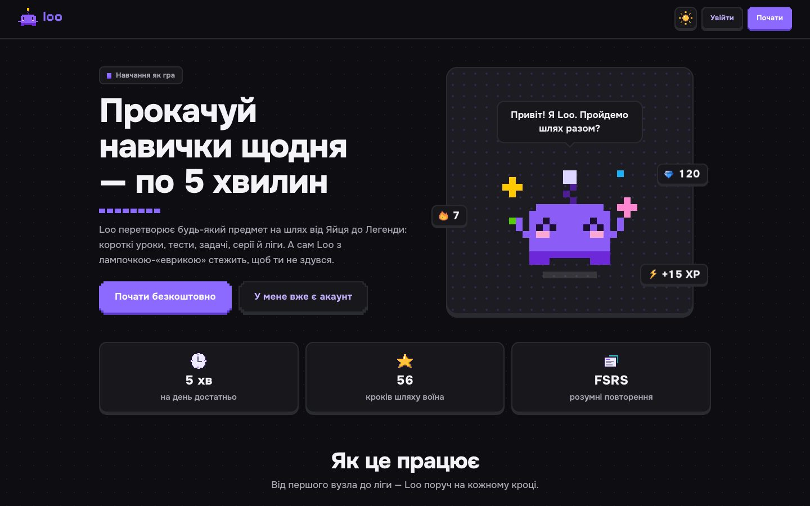

</div>

---

## What it is

Loo is a Duolingo-style app. Any subject becomes a path of short lessons, tests and reviews; learners earn XP and two currencies, keep a daily streak, compete in weekly leagues and dress their character. Explanations are in Ukrainian, answers are checked only on the server, and every learner's progress lives in their own Postgres rows under row-level security.

<table>
  <tr>
    <td width="50%">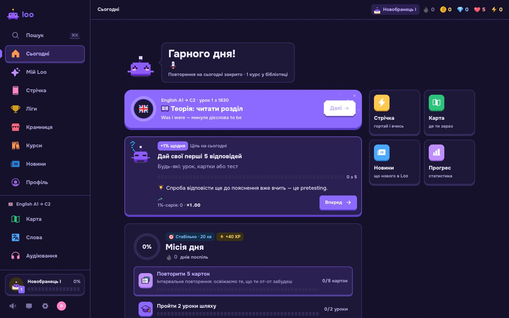</td>
    <td width="50%">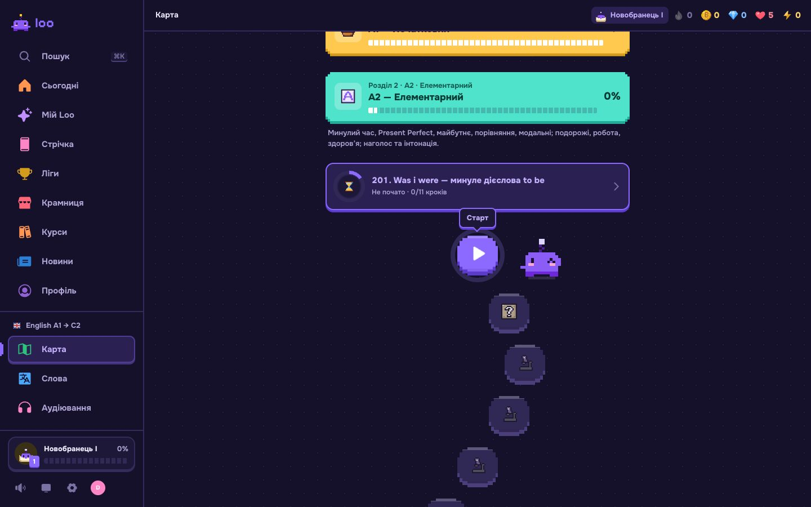</td>
  </tr>
  <tr>
    <td align="center"><b>Today</b>: daily mission, daily goal, continue where you stopped</td>
    <td align="center"><b>Map</b>: sections, topics, lessons, tests and exams</td>
  </tr>
  <tr>
    <td>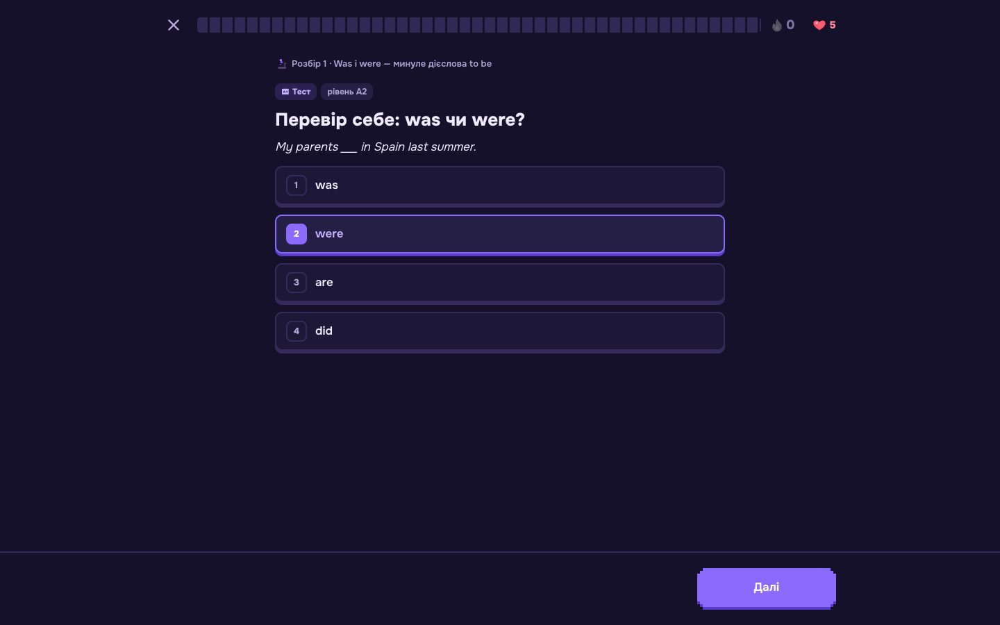</td>
    <td>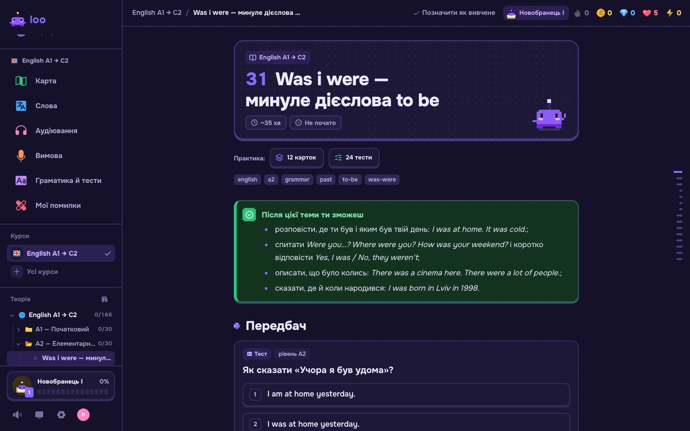</td>
  </tr>
  <tr>
    <td align="center"><b>Lesson</b>: predict, break down, practise; hearts for mistakes, XP for answers</td>
    <td align="center"><b>Theory</b>: topic articles with tables, diagrams and exercises inline</td>
  </tr>
  <tr>
    <td>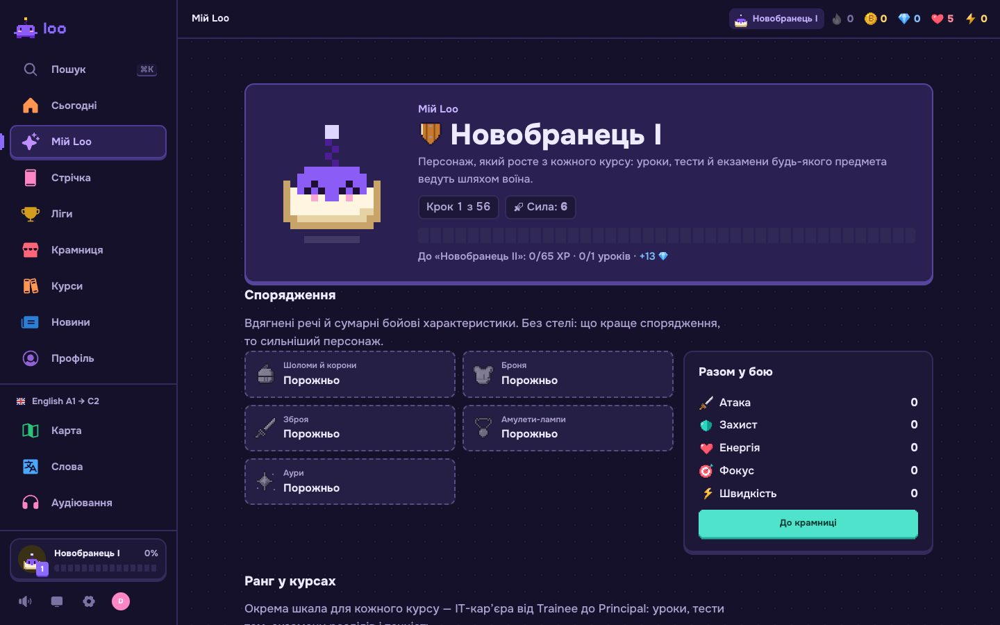</td>
    <td>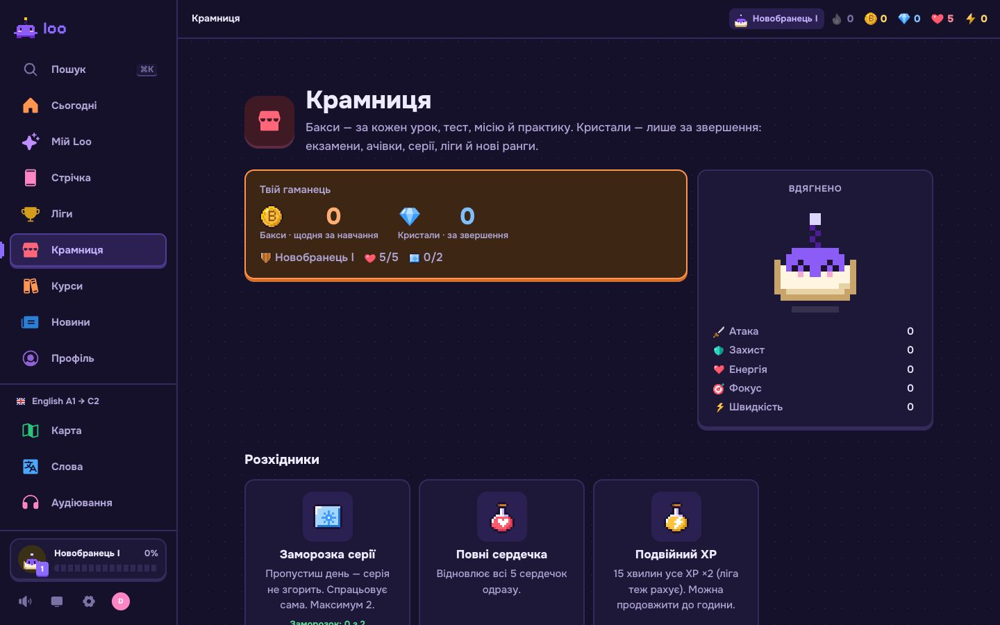</td>
  </tr>
  <tr>
    <td align="center"><b>My Loo</b>: a 56-step rank path, gear and stats</td>
    <td align="center"><b>Shop</b>: streak freezes, hearts, double XP, skins and armour</td>
  </tr>
</table>

<div align="center">
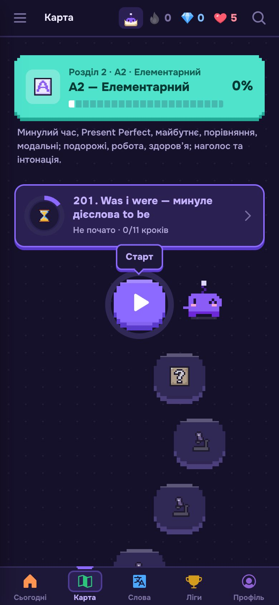&nbsp;&nbsp;
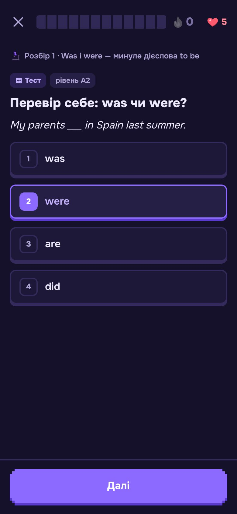&nbsp;&nbsp;
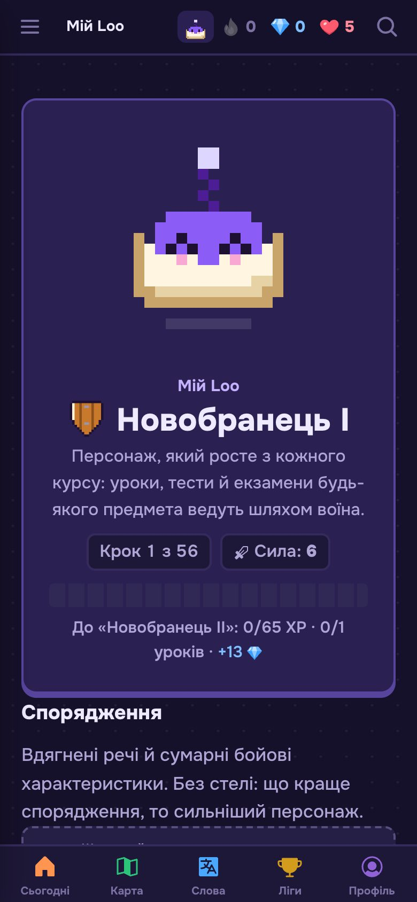

<sub>On a phone: bottom navigation, large targets, installable as a PWA.</sub>
</div>

## Courses

| Course | Sections | Topics | Lessons | Exercises | Reels |
| --- | ---: | ---: | ---: | ---: | ---: |
| **English A1 → C2**: grammar, 4,287 words, listening, pronunciation, reading, IELTS guide | 6 (A1…C2) | 166 | 2,361 | 9,375 | 499 |
| **JavaScript Zero → Pro**: from variables to the event loop, patterns and interviews | 9 | 73 | 779 | 1,759 | 271 |

A course is a Markdown guide written in Obsidian plus a `course.yaml` manifest. A compiler turns it into a bundle of sections, topics, lessons, topic tests, section exams and exercise pools. A new course is new content, not new code ([docs/COURSE_FORMAT.md](docs/COURSE_FORMAT.md)).

## Engineering highlights

- **The server is the source of truth.** Answer keys never reach the browser in graded contexts; XP, hearts, leagues and currencies change in one server transaction ([SECURITY.md](docs/SECURITY.md)).
- **Row-level security everywhere.** Every progress table has `user_id` and an `own_rows` policy; server-only tables (analytics, admin log, email) have no grants for `anon` or `authenticated`.
- **Learning science, not just points.** Lessons follow predict, break down, practise (pretesting, interleaving, retrieval practice). FSRS spaced repetition for cards and words, a mistakes queue that releases a question only after two spaced correct answers ([LEARNING_PLAYBOOK.md](docs/LEARNING_PLAYBOOK.md)).
- **Adaptive placement test.** Binary search over CEFR levels with guessing protection and an "I don't know" option; per-skill levels drive which exercises come next ([LANGUAGE_COURSE.md](docs/LANGUAGE_COURSE.md)).
- **Many exercise types.** Single and multiple choice, "what does this code print", Parsons problems, gap fill, flashcards, coding tasks with auto-tests in a Web Worker, interview questions, listening and speaking with browser speech APIs.
- **Fast reads.** A page read is one statement through `readAll`, content is cached, round trips are kept to a minimum ([PERFORMANCE.md](docs/PERFORMANCE.md)).
- **Run like a product.** Own analytics with no third-party trackers, an admin for users and the game economy, an action log, a blog with SSG, OpenGraph cards, sitemap and IndexNow.
- **Tested.** 1,300+ unit tests on course, progress and game logic (Vitest), end-to-end flows in Playwright, layer boundaries enforced by ESLint.

## Architecture

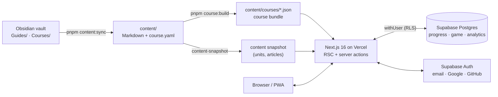

```
src/
  content/   vault -> domain model; block registry (quiz, word, listen, speak, pair, task...); Obsidian parser
  course/    course schema, bundle compiler, placement test, skills, adaptive selection (pure logic)
  progress/  XP, levels, FSRS, mistakes, streaks, achievements (no I/O)
  game/      ranks, currencies, shop, leagues, character
  db/        Drizzle schema and Postgres client
  server/    auth, actions, services, admin, analytics
  ui/        React components
  app/       Next.js routes (App Router)
```

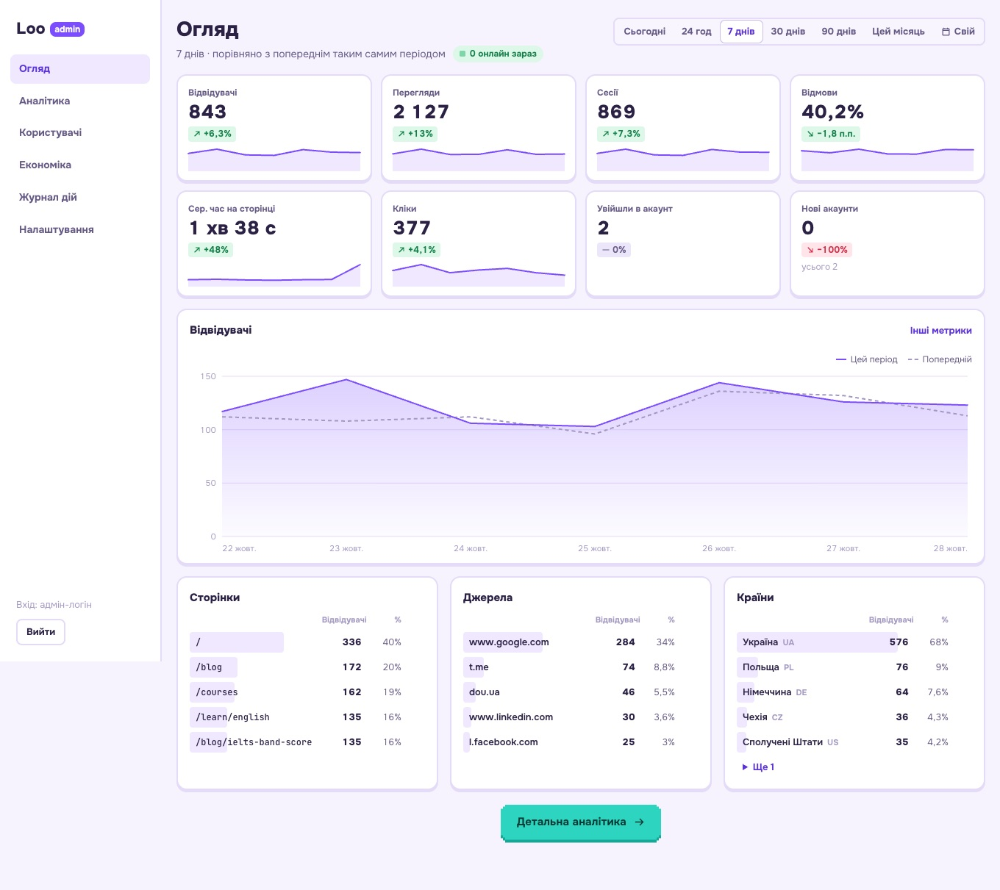

<sub>Admin analytics on local demo data.</sub>

## Stack

**Next.js 16** (App Router, React Compiler) · **React 19** · **TypeScript** strict · **Tailwind CSS 4** · **Drizzle ORM** + **postgres-js** · **Supabase** (Postgres, Auth, RLS) · **ts-fsrs** · **Zod** · **Vitest** · **Playwright** · **Vercel** (Fluid Compute) · **Resend** · Obsidian as the CMS.

## Getting started

Node.js 22.12+ and pnpm (`corepack enable`).

```bash
pnpm install
cp .env.example .env.local   # VAULT_PATH, DATABASE_URL, Supabase keys, ADMIN_EMAILS
```

```bash
pnpm db:local     # local Postgres (PGlite) on :54329, in a separate terminal
pnpm db:migrate   # schema + RLS
pnpm dev          # http://127.0.0.1:3000
```

Without Supabase keys you can work on the UI with `DEV_AUTH_BYPASS=1 pnpm dev` (only in `next dev` and only without keys). Sign-in setup: [docs/AUTH.md](docs/AUTH.md).

| Command | What it does |
| --- | --- |
| `pnpm dev` / `pnpm build` / `pnpm start` | development / build / production mode |
| `pnpm content:sync` | copies `Guides/` and `Courses/` from the vault into `content/` |
| `pnpm course:check <course>` / `pnpm course:build` | validates and compiles courses into bundles |
| `pnpm db:generate` / `pnpm db:migrate` | Drizzle migrations |
| `pnpm test` / `pnpm e2e` | unit tests (Vitest) / end-to-end (Playwright) |
| `pnpm lint` / `pnpm typecheck` | ESLint with layer boundaries / TypeScript |

## Docs

| Topic | File |
| --- | --- |
| Architecture and layers | [ARCHITECTURE.md](docs/ARCHITECTURE.md) |
| Content and course format | [CONTENT_SPEC.md](CONTENT_SPEC.md) · [COURSE_FORMAT.md](docs/COURSE_FORMAT.md) |
| Language courses, placement, skills | [LANGUAGE_COURSE.md](docs/LANGUAGE_COURSE.md) · [ENGLISH_SYLLABUS.md](docs/ENGLISH_SYLLABUS.md) · [SPEECH.md](docs/SPEECH.md) |
| How we teach | [LEARNING_PLAYBOOK.md](docs/LEARNING_PLAYBOOK.md) |
| Game and economy | [ECONOMY.md](docs/ECONOMY.md) · [BATTLES.md](docs/BATTLES.md) |
| Design | [DESIGN.md](docs/DESIGN.md) |
| Sign-in and security | [AUTH.md](docs/AUTH.md) · [SECURITY.md](docs/SECURITY.md) |
| Performance | [PERFORMANCE.md](docs/PERFORMANCE.md) |
| Blog, email, analytics, admin | [BLOG.md](docs/BLOG.md) · [EMAIL.md](docs/EMAIL.md) · [ANALYTICS.md](docs/ANALYTICS.md) · [ADMIN.md](docs/ADMIN.md) |
| Roadmap | [ROADMAP.md](docs/ROADMAP.md) |

Most docs are in Ukrainian.

## Data and privacy

- Each learner's progress is stored in Postgres with `user_id` under RLS; deleting the account deletes all progress (cascade).
- **Profile and account → Download my data** exports everything in JSON; **Delete account** removes the profile and progress.
- Site analytics stores IP and city for statistics; retention is described in [ANALYTICS.md](docs/ANALYTICS.md).

---

<div align="center"><sub>© Yaroslav Tsarenko · source available for review, all rights reserved to the code and content · <a href="https://playloo.app">playloo.app</a></sub></div>
