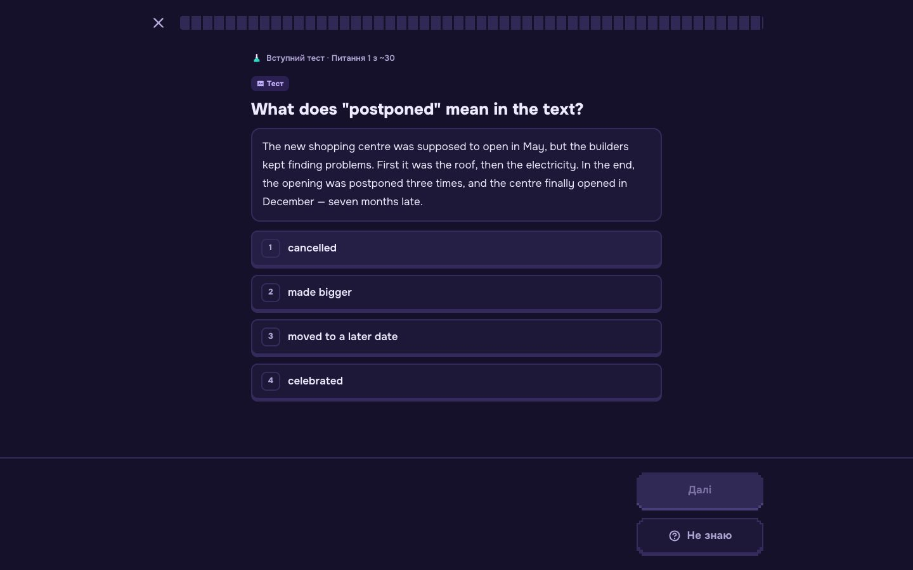
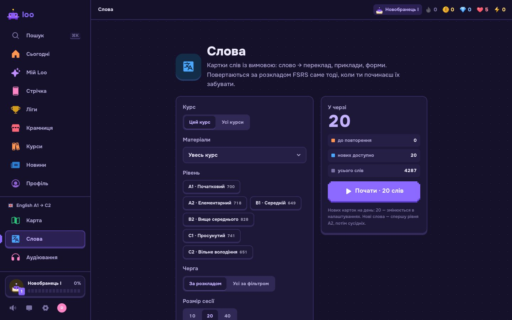
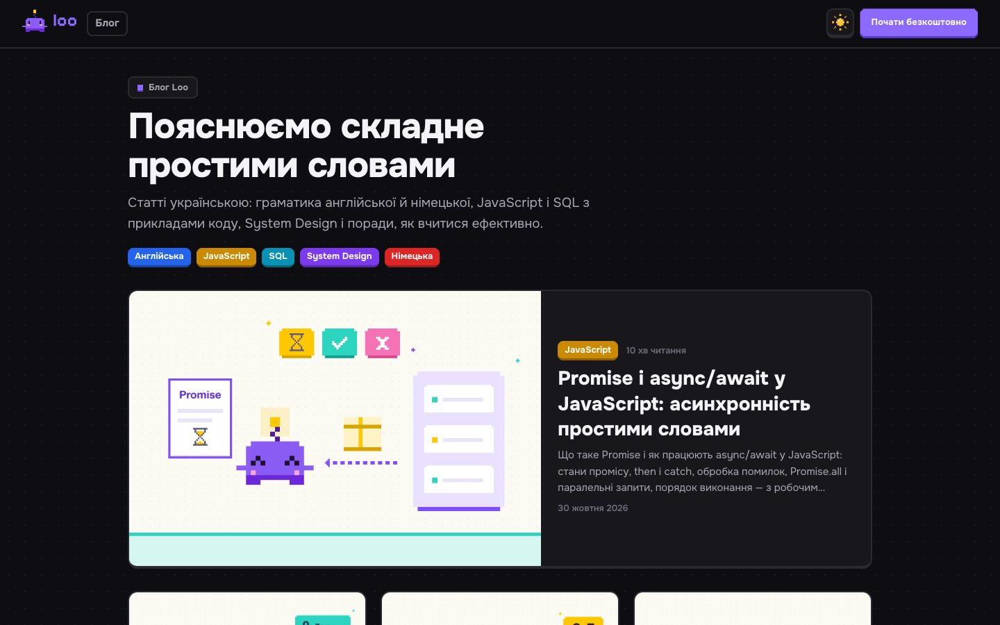
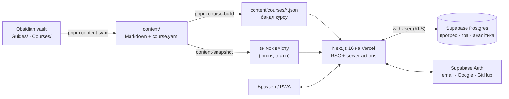

<div align="center">

# Loo — навчання як гра

**Прокачуй навички щодня — по 5 хвилин.** Англійська від A1 до C2, JavaScript від нуля до Pro, а поруч — піксельний
Loo, який росте разом із тобою.

[**playloo.app**](https://playloo.app) · [Блог](https://playloo.app/blog) · [Документація](#документація)


</div>

---

## Що таке Loo

Loo — це застосунок у стилі Duolingo для україномовних. Будь-який предмет перетворюється на шлях з коротких уроків,
тестів і повторень; за навчання ти отримуєш XP, бакси й кристали, тримаєш серію днів, змагаєшся в лігах і вдягаєш
свого персонажа. Пояснення — українською, перевірка відповідей — лише на сервері, прогрес кожного — у власному
рядку Postgres під RLS.

<table>
  <tr>
    <td width="50%"></td>
    <td width="50%"></td>
  </tr>
  <tr>
    <td align="center"><b>Сьогодні</b> — місія дня, денна мета, «продовжити» з того ж місця</td>
    <td align="center"><b>Карта</b> — шлях курсу: розділи, теми, уроки, тести й екзамени</td>
  </tr>
  <tr>
    <td></td>
    <td></td>
  </tr>
  <tr>
    <td align="center"><b>Урок</b> — передбач, розбери, закріпи; сердечка за помилки, XP за відповіді</td>
    <td align="center"><b>Теорія</b> — статті тем з таблицями, діаграмами й вправами просто в тексті</td>
  </tr>
  <tr>
    <td></td>
    <td></td>
  </tr>
  <tr>
    <td align="center"><b>Мій Loo</b> — шлях воїна з 56 кроків, спорядження й характеристики</td>
    <td align="center"><b>Крамниця</b> — заморозка серії, сердечка, подвійний XP, скіни й броня</td>
  </tr>
</table>

<div align="center">
&nbsp;&nbsp;
&nbsp;&nbsp;


<sub>На телефоні — нижня навігація, великі кнопки, PWA (можна встановити на головний екран).</sub>
</div>

## Курси

| Курс | Розділи | Теми | Уроки | Вправи | Рілси |
| --- | ---: | ---: | ---: | ---: | ---: |
| **English A1 → C2** — граматика, 4 287 слів, аудіювання, вимова, читання, IELTS-орієнтир | 6 (A1…C2) | 166 | 2 361 | 9 375 | 499 |
| **JavaScript Zero → Pro** — від змінних до event loop, патернів і співбесід | 9 | 73 | 779 | 1 759 | 271 |

Курс — це Markdown-посібник у Obsidian + маніфест `course.yaml`; компілятор збирає з нього бандл (розділи, теми,
уроки, тести тем, екзамени розділів, пули вправ). Новий курс = новий контент, без коду —
[docs/COURSE_FORMAT.md](docs/COURSE_FORMAT.md).

## Можливості

### Навчання
- **Уроки** з кроками «передбач → розбери → закріпи» (pretesting, interleaving, retrieval practice —
  [docs/LEARNING_PLAYBOOK.md](docs/LEARNING_PLAYBOOK.md)), сердечка за помилки, розбір наприкінці.
- **Типи вправ:** один / кілька варіантів, «що виведе код», «склади код» (Parsons), «заповни пропуски», флешкартки,
  задачі з автотестами у Web Worker, питання співбесіди.
- **Інтервальні повторення FSRS** для карток і слів; **«Мої помилки»** — окрема сесія, питання виходить після двох
  правильних відповідей з перервою.
- **Тести тем і екзамени розділів** із можливістю «перескочити розділ»; **стрічка-рілси** з короткими фішками.

### Мовний курс

<table>
  <tr>
    <td width="50%"></td>
    <td width="50%"></td>
  </tr>
  <tr>
    <td align="center"><b>Вступний тест</b> — адаптивний, ~30 питань, рівень за навичками й орієнтовний IELTS</td>
    <td align="center"><b>Слова</b> — 4 287 карток з вимовою, приклади, форми, FSRS-розклад</td>
  </tr>
</table>

- Адаптивний **вступний тест** по CEFR (бінарний пошук рівня, захист від вгадування, «Не знаю») —
  [docs/LANGUAGE_COURSE.md](docs/LANGUAGE_COURSE.md).
- **Рівень за навичками** (граматика, лексика, читання, аудіювання, вимова) після кожного тесту й підбір вправ під
  слабкі місця.
- **Аудіювання й вимова** — браузерний синтез і розпізнавання мовлення, мінімальні пари, диктанти, IELTS-форми;
  тексти для озвучки потрапляють у браузер лише після натискання «Слухати» ([docs/SPEECH.md](docs/SPEECH.md)).

### Гра
- **XP, бакси й кристали**, денна мета й серія з заморозками, ачівки, місія дня.
- **Шлях воїна** з 56 кроків і ранг у кожному курсі (Trainee → Principal / A1 → C2) —
  [docs/ECONOMY.md](docs/ECONOMY.md).
- **Тижневі ліги** (до 30 учнів, 10 рівнів від бронзи), підвищення й пониження.
- **Крамниця й спорядження** з характеристиками — фундамент для дуелей і босів ([docs/BATTLES.md](docs/BATTLES.md)).

### Блог і SEO



Статті простими словами про англійську, JavaScript, SQL і System Design (`blog/uk/*.md`): SSG, OpenGraph-картки,
sitemap, IndexNow. Нові статті пише запланована задача Claude тричі на тиждень — [docs/BLOG.md](docs/BLOG.md).

### Аналітика й адмінка


<sub>Скриншот на локальних демо-даних.</sub>

- **Власна аналітика без сторонніх сервісів:** перегляди, кліки, час на сторінці, джерела, UTM, країни й міста,
  пристрої — з фільтрами, порівнянням періодів і графіками ([docs/ANALYTICS.md](docs/ANALYTICS.md)).
- **Адмінка `/admin`:** огляд, детальна аналітика, користувачі (баланси, сердечка, бусти, предмети, бан), економіка
  гри, журнал усіх дій і налаштування ([docs/ADMIN.md](docs/ADMIN.md)).

## Як це влаштовано



- **Сервер — джерело правди.** Ключі відповідей не йдуть у браузер у графуваних контекстах; XP, серця, ліги й
  гроші рахує сервер в одній транзакції ([docs/SECURITY.md](docs/SECURITY.md)).
- **Кожна таблиця прогресу** має `user_id` і RLS-політику `own_rows`; серверні таблиці (аналітика, журнал адмінки,
  пошта) — без грантів для `anon` / `authenticated`.
- **Швидкість:** читання сторінки — один statement через `readAll`, кеш контенту, мінімум round trip
  ([docs/PERFORMANCE.md](docs/PERFORMANCE.md)).

```
src/
  content/   vault → доменна модель; реєстр блоків (quiz, word, listen, speak, pair, task…); парсер Obsidian
  course/    схема курсу, компілятор бандла, вступний тест, навички, адаптивний підбір (чиста логіка)
  progress/  XP, рівні, FSRS, помилки, серії, ачівки (без I/O)
  game/      ранги, валюти, крамниця, ліги, персонаж
  db/        схема Drizzle і клієнт Postgres
  server/    auth, actions, сервіси, адмінка, аналітика
  ui/        React-компоненти
  app/       маршрути Next.js (App Router)
```

## Стек

**Next.js 16** (App Router, React Compiler) · **React 19** · **TypeScript** strict · **Tailwind CSS 4** ·
**Drizzle ORM** + **postgres-js** · **Supabase** (Postgres, Auth, RLS) · **ts-fsrs** · **Zod** · **Vitest** ·
**Playwright** · **Vercel** (Fluid Compute) · **Resend** (листи) · Obsidian як CMS.

## Швидкий старт

Потрібні Node.js 22.12+ і pnpm (`corepack enable`).

```bash
pnpm install
cp .env.example .env.local   # VAULT_PATH, DATABASE_URL, ключі Supabase, ADMIN_EMAILS
```

```bash
pnpm db:local     # локальний Postgres (PGlite) на :54329 — в окремому терміналі
pnpm db:migrate   # схема + RLS
pnpm dev          # http://127.0.0.1:3000
```

Без ключів Supabase можна працювати над UI: `DEV_AUTH_BYPASS=1 pnpm dev` (лише `next dev` і лише без ключів — вхід
як локальний власник). Налаштування входу — [docs/AUTH.md](docs/AUTH.md).

### Команди

| Команда | Що робить |
| --- | --- |
| `pnpm dev` / `pnpm build` / `pnpm start` | розробка / збірка / production-режим |
| `pnpm content:sync` | копіює `Guides/` і `Courses/` з vault у `content/` |
| `pnpm content:check [посібник]` | перевіряє статті: блоки, id, посилання |
| `pnpm course:check <курс>` / `pnpm course:build` | перевіряє й компілює курси в бандли |
| `pnpm db:generate` / `pnpm db:migrate` | міграції Drizzle (на прод — лише під час збірки на Vercel) |
| `pnpm test` / `pnpm e2e` | unit-тести (Vitest) / e2e (Playwright) |
| `pnpm lint` / `pnpm typecheck` | ESLint (з межами шарів) / TypeScript |
| `pnpm admin:credentials [--vercel]` | новий пароль адмінки (хеш і секрет — у `.env.local` і Vercel) |

### Клавіатура

| Де | Клавіші |
| --- | --- |
| Будь-де | `⌘K` / `Ctrl+K` або `/` — пошук і дії · `⌘\` — бічна панель |
| Читалка | `M` — вивчено · `[` / `]` — попередній / наступний розділ |
| Картки | `Пробіл` — перевернути · `1` / `2` / `3` — не знав / важко / знав |
| Тести | `1`–`4` — варіант · `Enter` — перевірити / далі |

## Документація

| Тема | Файл |
| --- | --- |
| Архітектура й шари | [ARCHITECTURE.md](docs/ARCHITECTURE.md) |
| Формат контенту й курсів | [CONTENT_SPEC.md](CONTENT_SPEC.md) · [COURSE_FORMAT.md](docs/COURSE_FORMAT.md) |
| Мовні курси, вступний тест, навички | [LANGUAGE_COURSE.md](docs/LANGUAGE_COURSE.md) · [ENGLISH_SYLLABUS.md](docs/ENGLISH_SYLLABUS.md) · [SPEECH.md](docs/SPEECH.md) |
| Як ми вчимо | [LEARNING_PLAYBOOK.md](docs/LEARNING_PLAYBOOK.md) |
| Гра й економіка | [ECONOMY.md](docs/ECONOMY.md) · [BATTLES.md](docs/BATTLES.md) |
| Дизайн | [DESIGN.md](docs/DESIGN.md) |
| Вхід і безпека | [AUTH.md](docs/AUTH.md) · [SECURITY.md](docs/SECURITY.md) |
| Швидкодія | [PERFORMANCE.md](docs/PERFORMANCE.md) |
| Блог, пошта, аналітика, адмінка | [BLOG.md](docs/BLOG.md) · [EMAIL.md](docs/EMAIL.md) · [ANALYTICS.md](docs/ANALYTICS.md) · [ADMIN.md](docs/ADMIN.md) |
| Плани | [ROADMAP.md](docs/ROADMAP.md) |

## Дані й приватність

- Прогрес кожного — у Postgres з `user_id` під RLS; видалення акаунта видаляє весь прогрес (каскадом).
- **Профіль і акаунт → Завантажити мої дані** — усе про тебе в JSON; **Видалити акаунт** — профіль і прогрес.
- Аналітика збирає IP і місто для статистики сайту — опис і строк зберігання в [ANALYTICS.md](docs/ANALYTICS.md).

---

<div align="center"><sub>© Yaroslav Tsarenko · пропрієтарний код і контент · <a href="https://playloo.app">playloo.app</a></sub></div>
